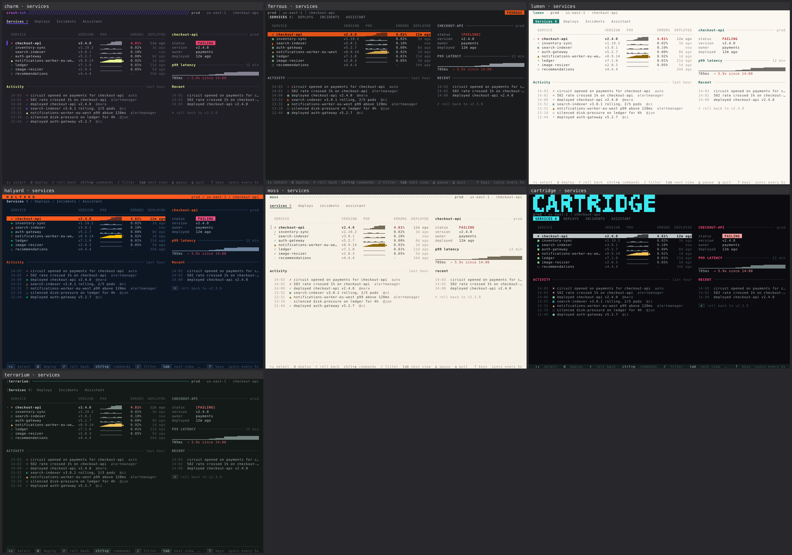
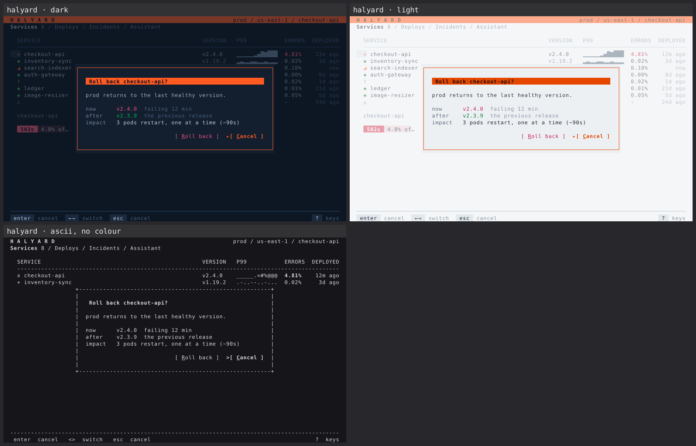
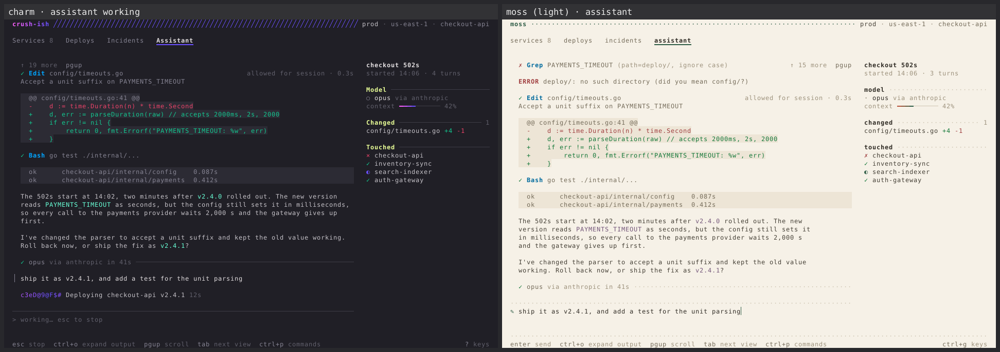
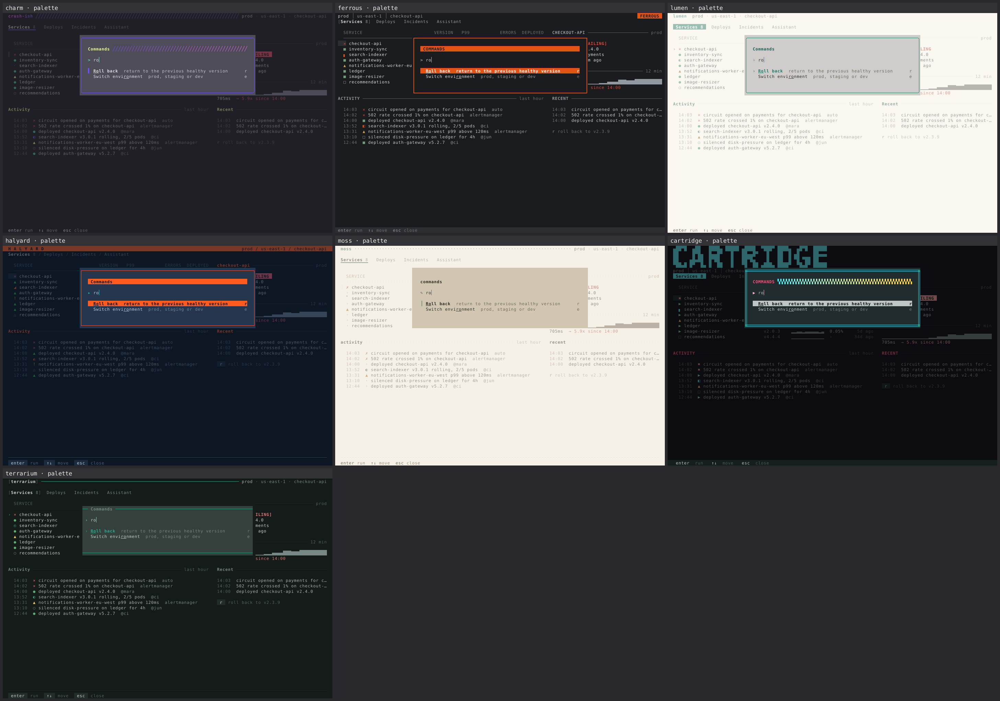

# bubbletea-tui

**An agent skill for designing and building terminal UIs that look as considered as Charm's
Crush, and unmistakably like *your* product.**

Models are excellent at HTML. Ask one for a TUI and you get the same app every time:
rounded borders around every region, the Lip Gloss README purple, emoji for icons,
"Loading...", a paragraph of help text, and a frame that tears at 79 columns. This skill
replaces those defaults with three things:

- **An idiom**: how a terminal app looks *designed*, read from Crush's source, not from
  screenshots. Whitespace and rules instead of boxes, four text levels, focus bars that
  never shift layout, the tool-call grammar, tags, toasts, one dialog with a scrim.
- **A brand system**: one theme file per product (roles, glyph vocabulary, 16 expression
  axes), derived from the brand's real colours, typeface and logo, with a lint that proves
  it isn't the default with a new palette.
- **Eyes**: a harness that renders every state of the app, a renderer that turns ANSI
  into honest PNGs (box drawing, blocks and braille drawn the way modern terminals draw
  them), a slop linter, and an adversarial critic loop. The model looks at the terminal
  before you do.



*Same app, same code, six themes: a Crush study, an industrial IoT tool, a telehealth
triage tool, a freight tracker, a notes app and a game-asset pipeline. Every theme is
derived with the skill's own tools.*

## Install

```sh
npx skills add jrschumacher/skill-bubbletea-tui
```

or copy `skills/bubbletea-tui` into `~/.claude/skills/` (or your agent's skills
directory).

Requirements: Go ≥ 1.26.7 (Bubble Tea v2.1, Lip Gloss v2.0.6, Bubbles v2.2). The
wordmark and logo converters also need Python 3 with Pillow and numpy; nothing else does.

## Use

Just ask for a TUI ("build a Bubble Tea dashboard for our job queues, brand colours
#0F5257 and #FF6F59"), or name a command:

| Command | What it does |
|---|---|
| `/bubbletea-tui init` | interview you, then write the design (product, users, brand) and the architecture (model, regions, forms, states and keys) into `TUI.md`, so every later change stays consistent. `teach` is an alias |
| `/bubbletea-tui brand` | turn brand colours, typeface and logo into a theme that's provably not the default |
| `/bubbletea-tui shape` | plan screens: column budgets at 80×24 and 120×40, states, keys, cell sketches |
| `/bubbletea-tui craft` | build from the kit with the render → lint → critique loop |
| `/bubbletea-tui critique` | a scored design review with two independent critics, defects cited by cell |
| `/bubbletea-tui audit` | technical pass: footprint, colour profiles, keys, clock, exit, perf |
| `/bubbletea-tui polish` | the last 10% |
| `/bubbletea-tui harden` | tiny terminals, huge data, light backgrounds, NO_COLOR, tmux, SSH, failures |
| `/bubbletea-tui animate` | motion that means something, on one clock |
| `/bubbletea-tui art` | terminal logos, wordmarks, backdrop fields, splash screens |
| `/bubbletea-tui restyle` | bring an existing (v1) Bubble Tea app onto the system |

## What's inside

```
skills/bubbletea-tui/
├── SKILL.md              the stance, the laws, per-domain DO/DON'T, the TUI slop test, the command router
├── references/           medium · idiom · color · layout · components · interaction · motion · brand
│                         cell-art · architecture · verify · anti-patterns, plus one file per command
├── tools/                Go, built once: go -C tools build -o ~/.cache/tuitools/ ./cmd/...
│   ├── cellshot          ANSI → PNG / GIF / contact sheet, drawn like Ghostty/Kitty/WezTerm draw it
│   ├── tuilint           slop + correctness lint on rendered frames and on Go source (rule IDs)
│   ├── tuivet            the code rules as a go vet tool, for editors and CI
│   ├── palette           derive a dark+light role palette from brand hexes (OKLCH, tinted neutrals, contrast-tuned)
│   └── diversity         are these themes actually different from each other and from the default?
├── scripts/              Python + Pillow, only for converting brand assets
│   ├── wordmark.py       a brand name in terminal cells, from a real font
│   └── logo2cells.py     a logo raster onto the cell grid, with lint
├── kit/                  a compiling Bubble Tea v2 module to copy from, not re-derive
│   ├── theme/            the theme engine: roles, glyphs, expressions → styles
│   ├── ui/               header, tabs, section, list, table, dialog + scrim, buttons, tags,
│   │                     alerts, toast, help/footer, tool calls, thinking, anim, progress,
│   │                     sparkline, tree, field, empty states, canvas
│   ├── themes/           seven themes (a default, a Crush study, five fictional brands)
│   └── cmd/showcase/     the reference app + harness (-golden, -state, -out, -profile, -light, -ascii)
└── evals/                cases for skill-creator, with fixtures
```

`cd skills/bubbletea-tui/kit && go test ./...` renders every theme × dark/light/ASCII ×
every state × five terminal sizes and asserts each frame is exactly W×H cells, plus
contrast floors on every palette.

## The loop

```sh
go run ./cmd/app -out frames -sizes 80x24,120x40         # every state
tuilint frames frames --theme themes/brand.json
cellshot frames/*-80x24.ansi --sheet sheet.png # look at it
# → adversarial critic subagent with the sheets, the brand read and the code → fix → again
```







## Roadmap and feedback

This is v0.1. It has been verified by the authors' own render, lint and critique loop,
but not yet by cold runs on real apps. The most useful thing you can do is build
something with it and file what it got wrong with the **Skill feedback** issue
template. [ROADMAP.md](ROADMAP.md) has the plan. It also covers the open problems that
are bigger than this repo: no accessibility standard for terminals, no semantic
locators for TUI testing, models that can't see terminals, and no shared ground truth
for what terminals render.

Working on the skill itself? Start with [AGENTS.md](AGENTS.md).

## Credits

The idiom is learned from [Charm](https://charm.land)'s
[Crush](https://github.com/charmbracelet/crush) and built on Bubble Tea, Lip Gloss,
Bubbles and Ultraviolet. The `charm` theme uses the
[Charmtone](https://github.com/charmbracelet/x/tree/main/exp/charmtone) palette as a
calibration study; it is Charm's identity, not a theme to ship. The skill's shape (a
design stance, named anti-patterns, a command router, deterministic detectors) is
inspired by Paul Bakaus' [Impeccable](https://impeccable.style). All other brands here
are fictional.

## License

MIT
