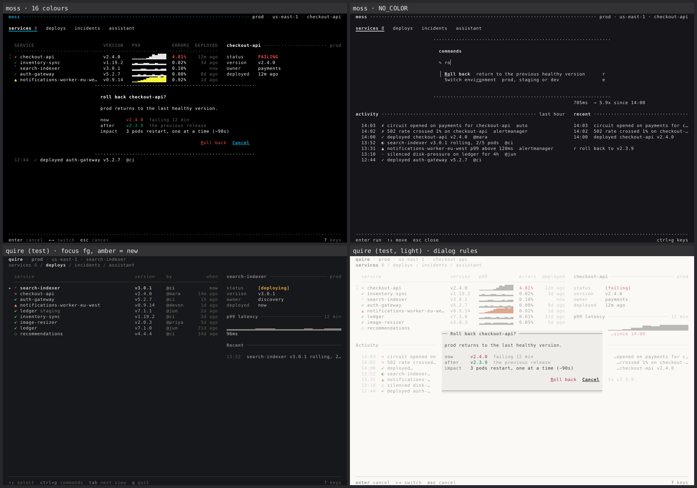
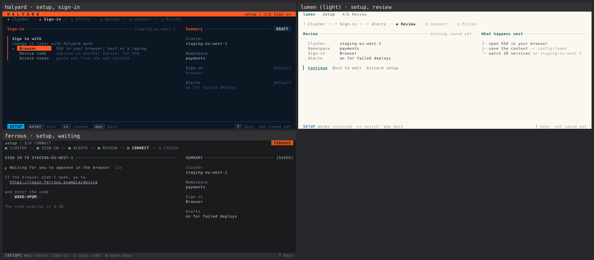

# bubbletea-tui

**An agent skill for designing and building terminal UIs that look as considered as Charm's
Crush, and unmistakably like *your* product.**

Models are excellent at HTML. Ask one for a TUI and you get the same app every time:
rounded borders around every region, the Lip Gloss README purple, emoji for icons,
"Loading...", a paragraph of help text, and a frame that tears at 79 columns. This skill
replaces those defaults with three things:

- **An idiom**: how a terminal app looks *designed*, read from Crush's source, not from
  screenshots. Whitespace and rules instead of boxes, four text levels, focus bars that
  never shift layout, the tool-call grammar, tags, toasts, one dialog with a scrim.
- **A brand system**: one theme file per product (roles, glyph vocabulary, 16 expression
  axes), derived from the brand's real colours, typeface and logo, with a lint that proves
  it isn't the default with a new palette.
- **Eyes**: a harness that renders every state of the app, a renderer that turns ANSI
  into honest PNGs (box drawing, blocks and braille drawn the way modern terminals draw
  them), a slop linter, and an adversarial critic loop. The model looks at the terminal
  before you do.


*Same app, same code, seven themes: a Crush study, an industrial IoT tool, a telehealth
triage tool, a freight tracker, a notes app, a game-asset pipeline and a home-lab fleet
tool. Every theme is derived with the skill's own tools.*

## Install

```sh
npx skills add jrschumacher/skill-bubbletea-tui
```

or copy `skills/bubbletea-tui` into `~/.claude/skills/` (or your agent's skills
directory).

**Fresh clones.** A cloud container clones your project without the skill. Commit what
`npx skills add` wrote under `.claude/skills/bubbletea-tui` (a copy, or a link into
`.agents/skills/`), or commit `skills-lock.json` plus a
`.claude/skills/bubbletea-tui -> ../../.agents/skills/bubbletea-tui` link and run
`npx skills experimental_install` after cloning (it restores `.agents/skills/` only);
SKILL.md § Setup says which to pick and what each pins.

### Install as a Claude Code plugin (adds the lint hook)

In Claude Code:

```
/plugin marketplace add jrschumacher/skill-bubbletea-tui
/plugin install bubbletea-tui@jrschumacher
```

On Claude Code 2.1.275 or later, one step does both:
`/plugin install bubbletea-tui --marketplace jrschumacher/skill-bubbletea-tui`.

The plugin carries the same skill, plus a hook. After every Edit or Write of a `.go` file
in a Bubble Tea or Huh module, it runs `tuilint code` and hands the edited file's
blocking (P0/P1) findings back to Claude, which fixes them before it moves on. Agents
skim prose; they can't skim a failing check. The first Go edit builds the tools (about
25 s on a cold Go cache); after that a check takes about 0.3 s.

The hook acts only in projects built with the skill, so your other Bubble Tea repos are
left alone: a `TUI.md` (which `init` writes) in the module root or above it up to the
repository root, or a copy of the kit's theme package (`theme/` or `internal/theme/`). It
runs the go command offline and read-only, so it never downloads modules or writes
`go.mod` or `go.sum`. If it can't lint at all (no Go on `PATH`, Go too old, a failed
build), it lets the edit through and shows you a one-line warning saying why, once per
cause; a failed build isn't retried until the plugin's sources change.

Install one or the other, not both, or the skill loads twice. Plugin skills are
namespaced, so the commands become `/bubbletea-tui:bubbletea-tui init` and so on.

Requirements: Go ≥ 1.26.7 (Bubble Tea v2.1, Lip Gloss v2.0.6, Bubbles v2.2, Huh v2.0).
The skill's tools are Go and build in one step on first use. Only the wordmark and logo
converters need Python 3 with Pillow and numpy.

## Use

Just ask for a TUI ("build a Bubble Tea dashboard for our job queues, brand colours
#0F5257 and #FF6F59"), or name a command. A new TUI goes `init` → `brand` → `shape` →
`craft`; an existing app goes `init` → `restyle`.

| Command | What it does |
|---|---|
| `/bubbletea-tui init` | interview you, then write the design (product, users, brand) and the architecture (model, regions, forms, states and keys) into `TUI.md`, so every later change stays consistent. `teach` is an alias |
| `/bubbletea-tui brand` | turn brand colours, typeface and logo into a theme that's provably not the default |
| `/bubbletea-tui shape` | plan screens: column budgets at 80×24 and 120×40, states, keys, cell sketches |
| `/bubbletea-tui craft` | build from the kit with the render → lint → critique loop |
| `/bubbletea-tui critique` | a scored design review with two independent critics, defects cited by cell |
| `/bubbletea-tui audit` | technical pass: footprint, colour profiles, keys, clock, exit, perf |
| `/bubbletea-tui polish` | the last 10% |
| `/bubbletea-tui harden` | tiny terminals, huge data, light backgrounds, NO_COLOR, tmux, SSH, failures |
| `/bubbletea-tui animate` | motion that means something, on one clock |
| `/bubbletea-tui art` | terminal logos, wordmarks, backdrop fields, splash screens |
| `/bubbletea-tui restyle` | raise an existing app (v1 or v2, Huh forms included) to the idiom and your theme, not just recolour it |

## What's inside

```
skills/bubbletea-tui/
├── SKILL.md              the stance, the laws, per-domain DO/DON'T, the TUI slop test, the command router
├── references/           medium · idiom · color · layout · components · interaction · motion · brand
│                         cell-art · architecture · verify · anti-patterns, plus one file per command
├── tools/                Go, built once per project: go -C <skill>/tools build -o "$PWD/.tuitools/" ./cmd/...
│   ├── cellshot          ANSI → PNG / GIF / contact sheet, drawn like Ghostty/Kitty/WezTerm draw it
│   ├── tuilint           slop + correctness lint on rendered frames, on Go source and on TUI.md's keys (rule IDs)
│   ├── tuivet            the code rules as a go vet tool, for editors and CI
│   ├── palette           derive a dark+light role palette from brand hexes (OKLCH, tinted neutrals, contrast-tuned)
│   ├── diversity         are these themes actually different from each other and from the default?
│   └── feedback          draft, dedupe and file an issue here from the agent, on your yes
├── scripts/              Python + Pillow, only for converting brand assets
│   ├── wordmark.py       a brand name in terminal cells, from a real font
│   └── logo2cells.py     a logo raster onto the cell grid, with lint
├── kit/                  a compiling Bubble Tea v2 module to copy from, not re-derive
│   ├── theme/            the theme engine: roles, glyphs, expressions → styles
│   ├── ui/               header, tabs, section, list, table, dialog + scrim, buttons, tags,
│   │                     alerts, toast, help/footer, tool calls, thinking, anim, progress,
│   │                     sparkline, tree, field, empty states, canvas; Huh forms themed
│   │                     from the brand, a stepper and a summary panel for wizards
│   ├── themes/           eight themes (a default, a Crush study, six fictional brands)
│   └── cmd/showcase/     the reference app (an ops dashboard and a first-run setup wizard)
│                         + harness (-golden, -state, -out, -profile, -light, -ascii, -first-run)
.claude-plugin/           plugin.json + marketplace.json: the repo as a Claude Code plugin
hooks/                    the plugin's PostToolUse hook: tuilint code after every Go edit
evals/                    cases for skill-creator, with fixtures (outside the skill: installs don't ship them)
```

`cd skills/bubbletea-tui/kit && go test ./...` renders every theme × dark/light/ASCII ×
every state × five terminal sizes and asserts each frame is exactly W×H cells, plus
contrast floors on every palette, every advertised key handled in every state, and no
Huh default colour in the wizard's frames. CI also renders and lints every theme in the
variants `.github/workflows/ci.yml` lists (seven today: dark, light, ASCII, 256, 16 colours
dark and light, and NO_COLOR).

## The loop

```sh
go -C <skill>/tools build -o "$PWD/.tuitools/" ./cmd/...   # once per project (gitignored): cellshot, tuilint, palette, diversity, tuivet
go run ./cmd/app -out frames -sizes 80x24,120x40           # every state (and -light, -ascii, -profile ansi256|ansi, NO_COLOR=1)
tuilint frames frames --theme themes/brand.json            # slop and correctness, by rule ID
tuilint code .                                             # the same for the Go source
cellshot frames/*-80x24.ansi --sheet sheet.png             # look at it
# → adversarial critic subagent with the sheets, the brand read and the code → fix → again
```







## Feedback

The skill gets better from what it gets wrong in real builds, and your agent sees that
first. When the skill, the kit or a tool cost it a round (a rule the kit contradicts, a
lint that fired on a correct frame, a component it had to write, a slow tool), it offers
to file an issue here at the next natural stop, with the `feedback` tool
(`references/cmd-feedback.md`):

```sh
feedback similar --title "F-CONTRAST fires on a ruled dialog's scrim"   # file on an existing issue instead?
feedback draft --kind bug --title "…" --field area="tuilint frames" …    # the exact issue; nothing is sent
feedback submit --kind bug --title "…" …                                 # gh issue create, or a prefilled link
```

It shows you the draft first and files only on your yes. Your project's path, name and
module path, your home directory and your user name are redacted, and it leaves out your
code and app names unless you approve them. Without a signed-in `gh` it files nothing:
it prints a link to the issue form with every field filled in, and asks before opening
your browser. Forks set `FEEDBACK_REPO=owner/name`.

Filing by hand works the same way: pick a form on the
[new issue](https://github.com/jrschumacher/skill-bubbletea-tui/issues/new/choose) page.

| Form | For | Label |
|---|---|---|
| Bug | the skill, kit or a tool got it wrong (with the miss class: never said / said and missed / not expressible in prose) | `bug` |
| Performance | a tool or kit path too slow for the loop: the command, timing, sizes | `performance` |
| Eval suggestion | a prompt and the assertion that would have caught a mistake | `eval` |
| Feature | a component, rule or flag the agent had to invent | `enhancement` |

All four carry `feedback`.

## Roadmap

This is v0.1, verified by the authors' own render, lint and critique loop and by one
dogfood run so far: a `restyle` of a real CLI's Huh setup wizard. That run's misses (a
recolour instead of the idiom, Huh's default colours, flipping button order) are now eval
cases, lint rules and kit code. The most useful thing you can do is build something with
it and file what it got wrong (§ Feedback). [ROADMAP.md](ROADMAP.md) has the plan. It also covers the open problems that
are bigger than this repo: no accessibility standard for terminals, no semantic
locators for TUI testing, models that can't see terminals, and no shared ground truth
for what terminals render.

Working on the skill itself? Start with [AGENTS.md](AGENTS.md).

## Credits

The idiom is learned from [Charm](https://charm.land)'s
[Crush](https://github.com/charmbracelet/crush) and built on Bubble Tea, Lip Gloss,
Bubbles, Huh and Ultraviolet. The `charm` theme uses the
[Charmtone](https://github.com/charmbracelet/x/tree/main/exp/charmtone) palette as a
calibration study; it is Charm's identity, not a theme to ship. The skill's shape (a
design stance, named anti-patterns, a command router, deterministic detectors) is
inspired by Paul Bakaus' [Impeccable](https://impeccable.style). All other brands here
are fictional.

## License

MIT
